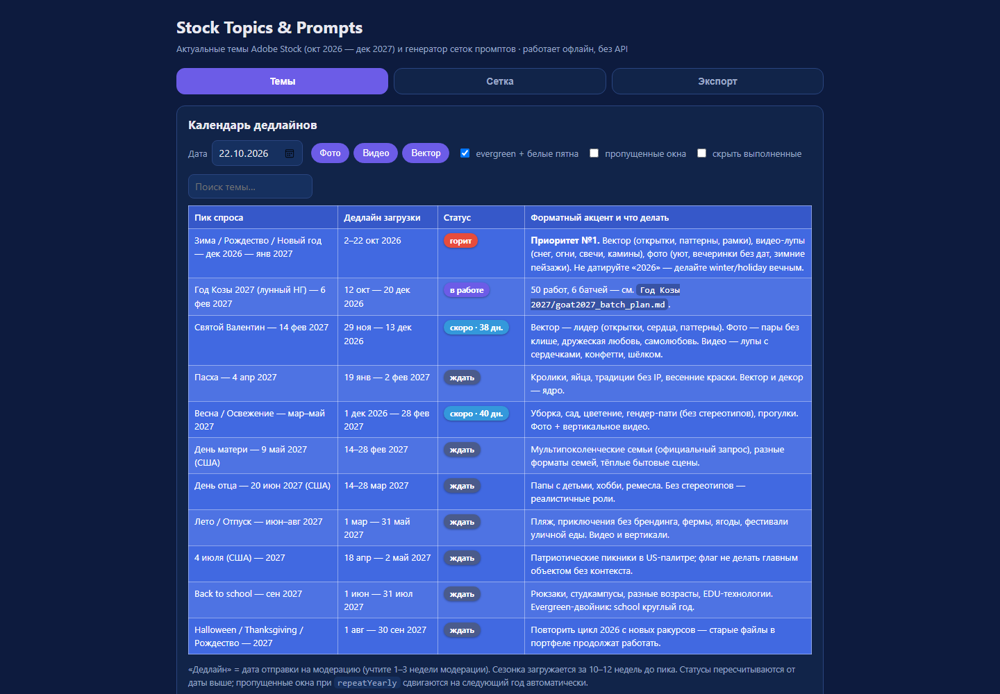
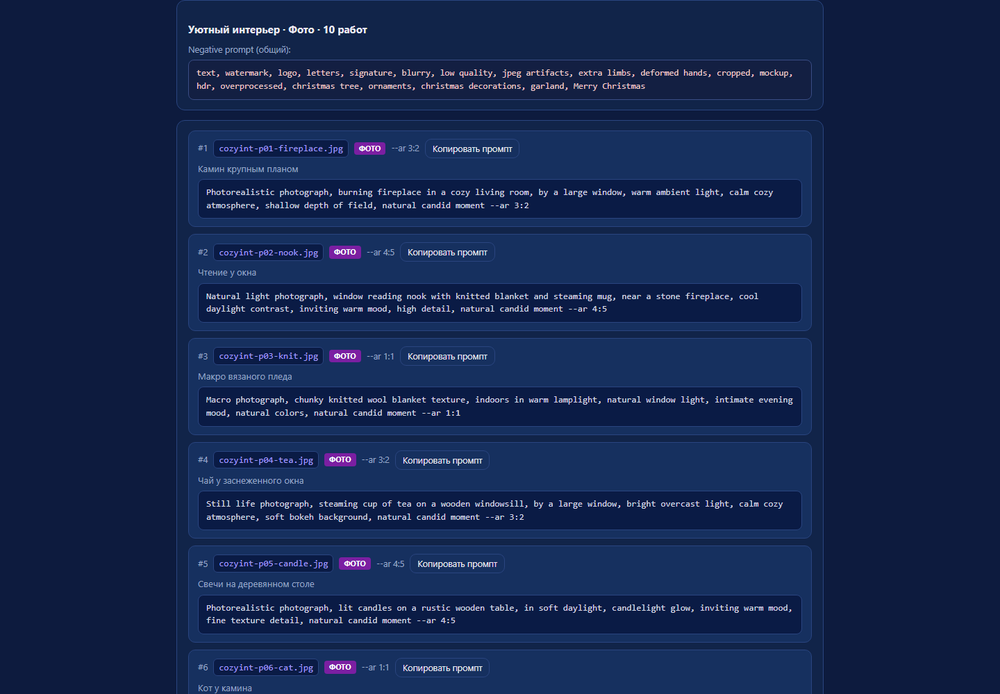
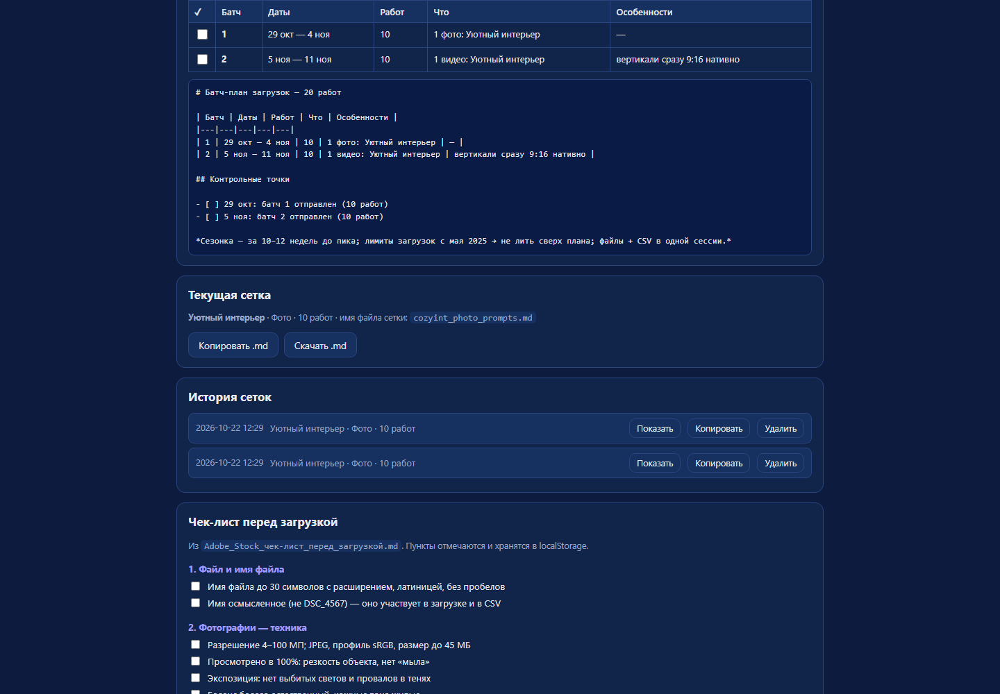
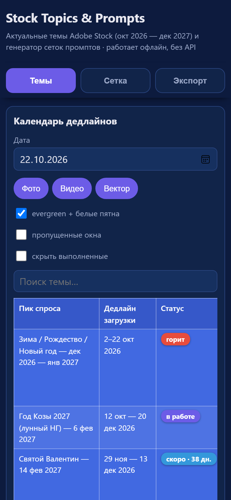
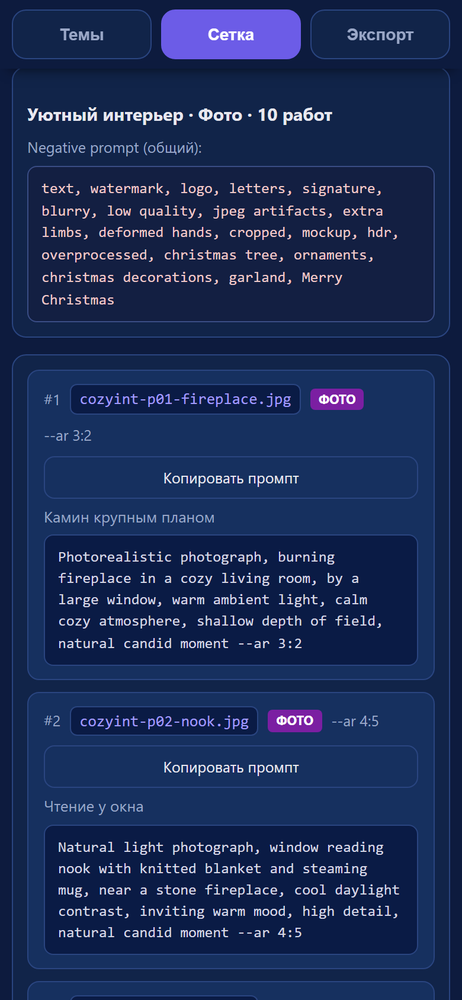

<p align="center"></p>

# Stock Topics & Prompts

Актуальные темы Adobe Stock (окт 2026 — дек 2027) и генератор готовых сеток промптов
для фото / видео / вектора. Работает **офлайн, без API и без интернета** — один
HTML-файл со всеми данными внутри.

**Открыть приложение:**
[на телефоне и в браузере (публичная ссылка)](https://ei2405ei-art.github.io/stock-metadata-generator/Promts%20october%202026/stock-topics-prompts.html)
· или двойным кликом по `stock-topics-prompts.html` на компьютере

## Скриншоты

### Вкладка «Темы» — календарь дедлайнов



### Вкладка «Сетка» — готовые промпты



### Вкладка «Экспорт» — батч-план, история, чек-лист



### На телефоне

<p align="center">
  
  &nbsp;&nbsp;&nbsp;
  
</p>

## Быстрый старт

**Компьютер:** двойной клик по `stock-topics-prompts.html` — откроется в любом
браузере. Ничего устанавливать не нужно.

**Телефон (с интернетом):** откройте
[публичную ссылку](https://ei2405ei-art.github.io/stock-metadata-generator/Promts%20october%202026/stock-topics-prompts.html)
и установите как приложение:

- **Android (Chrome):** меню «⋮» → «Установить приложение»;
- **iPhone (Safari):** «Поделиться» → «На экран "Домой"».

**Телефон без интернета (та же Wi-Fi-сеть, что и ПК):** запустите
`запуск-для-телефона.bat` и откройте напечатанный в консоли адрес
(см. [Инструкцию](Инструкция%20—%20Stock%20Topics%20and%20Prompts.md)).

## Возможности

- **Темы** — сезонный календарь с дедлайнами (статусы «горит / скоро / ждать /
  пропущено»), 41 тема, evergreen-ниши и белые пятна, фильтры по формату, поиск,
  отметки «выполнено»;
- **Сетка** — из выбранной темы генерирует 10/20 промптов: имя файла ≤30 символов,
  `--ar` в конце, negative prompt, посевные ключи, русское описание сюжета —
  всё копируется одной кнопкой;
- **Экспорт** — батч-план загрузок по 5–10 работ с датами и контрольными точками,
  история сеток, markdown-вывод, чек-лист Adobe перед загрузкой;
- **Видео** — 40% сетки вертикали 9:16 сразу с ключами `vertical` + `video`;
- **Вектор** — везде `no text`, превью и пост-обработка по правилам Adobe.

## Структура

| Файл | Назначение |
|---|---|
| `stock-topics-prompts.html` | Всё приложение (HTML + CSS + JS, один файл) |
| `Инструкция — Stock Topics and Prompts.md` | Подробная инструкция по вкладкам и рабочему циклу |
| `SKILL.md` | Техническое ТЗ: data model, hard rules, verification |
| `phone-server.js` + `запуск-для-телефона.bat` | Локальный сервер для телефона без интернета |
| `icon-180.png`, `icon-512.png`, `manifest.webmanifest` | Иконка и манифест для ярлыка на телефоне |
| `tools/make-screenshots.js` | Пересъёмка скриншотов: `node tools/make-screenshots.js` |
| `screenshots/` | Скриншоты для этого README |

## Разработка

Приложение — один HTML-файл без зависимостей и сборки. Проверка перед публикацией:

```bash
node --check <вырезанный из HTML JS>   # синтаксис
node tools/make-screenshots.js         # переснять скриншоты (headless Edge)
```

JS в файле разделён маркером `/* ================= UI ================= */`:
часть до маркера — данные и логика (тестируется в Node), часть после — DOM/UI.
Подробности — в [SKILL.md](SKILL.md).

## Ссылки

- [Инструкция для пользователя](Инструкция%20—%20Stock%20Topics%20and%20Prompts.md)
- [ТЗ и архитектура (SKILL.md)](SKILL.md)
- [Metadata Generator](../metadata-generator.html) — title/keywords для готовых работ
- [Публичный сайт проекта](https://ei2405ei-art.github.io/stock-metadata-generator/)
